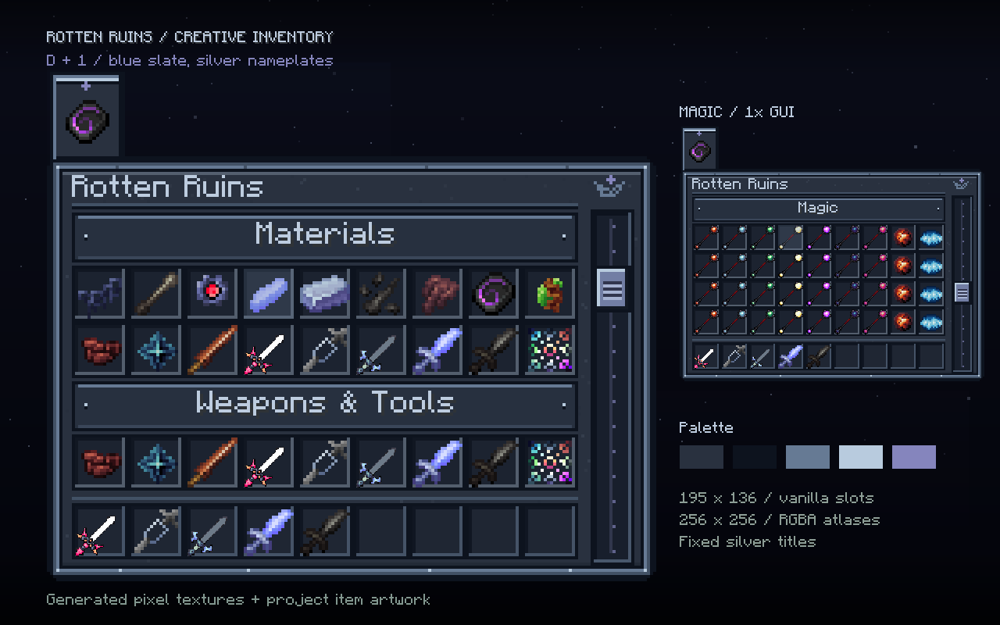

# 创造物品栏专属贴图

已接入 **D + 1：冷蓝灰银边 + 金属铭牌**。
深板岩底板、银色金属边框、暗紫点缀，分区使用凹面铭牌和固定银色标题。
已替换创造栏的彩虹色带及流动彩字；该界面不再依赖 彩虹着色器。
只应用于本模组分区标签，分区数据、点击拦截和滚动逻辑保持原有实现。



## 生成和预览

在仓库根目录执行（生成器需要 Python + Pillow，预览需要项目原有 JDK/LWJGL 环境）：

```powershell
python tools/generate-creative-inventory-textures.py
cmd /c "tools\gui-preview\gui_preview.cmd -Scene creative_inventory"
```

生成器输出可复现；再次执行会覆盖生成的 PNG，手工重绘前请备份。
预览输出 `build/gui-preview/creative_inventory.png`，本文截图是该文件的副本。
当前样式静态，不再导出动画相位图。

## 当前资源与坐标

资源目录：`src/main/resources/assets/rotten_ruins/textures/gui/creative_inventory/`。
三张图均为 256×256 RGBA，1 贴图像素对应 1 GUI 像素。

| 资源 | 使用区域 | 用途 |
| --- | --- | --- |
| `tab_items.png` | `(0,0)`，195×136 | 底板、9×5 槽位、快捷栏、滚动轨道 |
| `tabs.png` | `(26×列,0/32)`，26×32 | 顶部未选 / 选中标签，列 0–6 |
| `tabs.png` | `(26×列,64/96)`，26×32 | 底部未选 / 选中标签 |
| `tabs.png` | `(232,0)` / `(244,0)`，12×15 | 可用 / 禁用滚动滑块 |
| `dividers.png` | `(0,0)`，162×18 | 金属铭牌 |

网格井左上为 `(8,17)`，间距 18，内槽 16×16；快捷栏井从 `(8,111)` 起。
滚动滑块从 `(175,18)` 起，最远移动 95 像素。标题在 `(8,6)`；
`RegisterTab` 配置银色标题 `#BDCCDF` 和蓝灰半透明槽位悬停色 `0x40667A94`。

铭牌在 Foreground 事件绘制，完整遮住隔断行的空槽井和悬停高亮。
贴图和标题都使用面板相对坐标，经 `GuiGraphics` 的 PoseStack 统一平移；
不再使用立即绘制的 shader 顶点或手动切换 GL 状态。

## 验证边界

GUI 预览使用与游戏相同的 PNG 和固定色文字，展示 1× / 2× GUI；物品排列为展示样例。
`gradlew.bat compileJava --offline` 已通过。
未启动 Minecraft 验证点击、滚动和其它模组组合效果。

## 维护

只保留冷蓝灰银边与金属铭牌这套正式方案。绘制、调色和铭牌生成均在同一个脚本内；
修改脚本后重新生成资源并运行预览即可。底板和标签页按 Minecraft 1.20.1 UV 布局生成。
铭牌标题为运行时本地化文字，限宽 142 像素，超长以省略号收尾，避开两侧铆钉。
