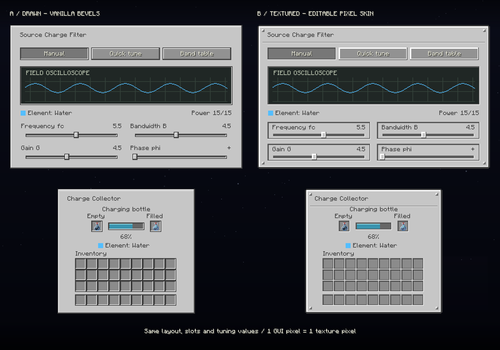

# 源荷机器 GUI：两套 Minecraft 风格提案

已选择方案 B 并接入实机 `SourceMachineScreen`，配色按后续要求改为方案 A 的原版灰色。方案 A 保留为设计对照。

**游戏实际读取的纹理目录：`src/main/resources/assets/rotten_ruins/textures/gui/source_machine/`。后续请直接修改此目录中的 PNG。**

源码核对：`SourceWireBlock` 是导线，没有菜单／独立页面；实际打开滤波器和集荷器容器的是 `SourceMachineBlock`，客户端共用 `SourceMachineScreen`。本提案覆盖该屏幕的手动调参、快捷预设、波段表、集荷器四种视图。



## 方案 A：直接绘制原版容器风格

- 不透明 `#C6C6C6` 底板，整数像素直角轮廓，上／左亮边、下／右暗边。
- 凹陷槽位、方形滑块、按下的标签页，取消圆角、半透明卡片和圆形滑块。
- 灰底使用深灰文字；元素通过色块表达，避免浅黄色／浅蓝色文字在灰底上不清晰。
- 示波器维持深色底，但曲线使用实际 `SourceWaveform.points` 采样并按 GUI 像素量化，统一像素质感。
- 落地方式：把当前 `panel`、按钮、滑块的装饰绘制换为 `GuiGraphics.fill`，不再要求 SDF 着色器；网络与操作逻辑继续使用现有实现。

优点是原版感明确、无需新增纹理。后续美术定制需要修改绘制代码。

## 方案 B：程序生成占位 PNG，再由美术重绘

- 使用方案 A 的 `#C6C6C6` 灰色底板、灰色按钮／槽位与白亮边；保留方案 B 的阶梯外角、铆钉、深色仪表凹槽及最近邻采样。
- 静态底板和槽位来自 PNG；按钮来自九宫格图集，边缘固定为 2 个 GUI 像素。
- 标题、翻译文本、物品、元素色块、波形、参数值和进度实时叠加，均未烘焙进底板。
- 落地方式：底板使用 `GuiGraphics.blit`，显式传入真实贴图宽高；按钮按本场景的九宫格切片绘制。保持既有菜单坐标与滑块命中区域，替换 PNG 即可更新外观。

适合计划后续手绘纹理的方向。当前原版灰色仍为可替换的占位配色。

### 可重绘资源

正式资源位于 `src/main/resources/assets/rotten_ruins/textures/gui/source_machine/`，**1 texel = 1 GUI 像素**。本目录 [textures](textures/) 为同步更新配色的生成器备份，游戏不会读取它。按原尺寸重绘即可；不要把文字、瓶子图标、波形、进度或当前选中状态画进底板。

| 文件 | 尺寸 | 内容 |
|---|---|---|
| `filter_manual.png` | 372×230 | 底板、仪表背景、四条调参凹槽 |
| `filter_quick.png` | 372×230 | 底板、仪表背景；预设按钮独立叠加 |
| `filter_bands.png` | 372×230 | 底板、表格底色；全部表格文字独立叠加 |
| `collector.png` | 220×200 | 底板、槽位、进度槽 |
| `widgets.png` | 80×20 RGBA | 按钮三态及滑块，空白区域透明 |

`widgets.png` 坐标使用左闭右开区间：

| 区域 | x / y / w / h | 用途 |
|---|---|---|
| 常态 | 0 / 0 / 20 / 20 | 未选中按钮 |
| 按下／选中 | 20 / 0 / 20 / 20 | 当前页签、当前元素预设 |
| 悬停／键盘焦点 | 40 / 0 / 20 / 20 | 已预留；静态预览未模拟鼠标焦点 |
| 滑块 | 60 / 0 / 8 / 10 | 原尺寸叠加，不做九宫格 |

按钮 20×20 的四边各固定 2px，中心和边条拉伸。重绘时保留该切片约定。滤波器在窄窗口中收缩：底板左右各保留 16px、中间横向拉伸；文字和控件按实时布局叠加。手动页四个 165×28 调参凹槽按下表分别从 `filter_manual.png` 裁出，左右各固定 12px，避免整张压缩造成两列错位。手动页 y=155..217 的空隙底色取自 `filter_quick.png` 同位置。

### 布局锚点

相对于底板左上角，沿用现有屏幕的默认布局：

| 区域 | x / y / w / h |
|---|---|
| 滤波器示波区域 | 16 / 66 / 340 / 62 |
| 三个页签 | x = 16 + i×114，y = 36，110×20 |
| 四个手动控件 | x = 16 + (i%2)×175，y = 155 + (i/2)×35，165×28 |
| 八个预设按钮 | x = 17 + (i%4)×86，y = 155 + (i/4)×35，80×27 |
| 集荷器输入／输出物品 | 55 / 52、149 / 52，各 16×16 |
| 集荷器背包 | 首格 29 / 112，9×3，步距 18 |
| 快捷栏 | 首格 29 / 170，9 格，步距 18 |
| 进度槽／可填充区域 | 81 / 54 / 58 / 12；83 / 56 / 54 / 8 |

## 复现

仓库根目录执行，需要 Python + Pillow、JDK 17 和现有 GUI 预览工具依赖：

```powershell
python tools/generate-source-gui-placeholders.py
javac -encoding UTF-8 -d build/circuit-test src/main/java/org/bytechen/rottenruins/overworld/energy/ElementBand.java src/main/java/org/bytechen/rottenruins/overworld/energy/SourceWaveform.java
cmd /c "tools\gui-preview\gui_preview.cmd -Scene source_machine_styles -Time 2 -Width 800 -Height 560 -OutDir docs\proposals\source-gui\previews"
```

生成器只覆盖本提案目录 `textures/` 的五张设计备份，不会覆盖正式资源。预览场景已改为读取正式资源；直接修改正式资源 PNG 后，仅运行最后一条命令即可查看改图结果。需要恢复占位图时，再手工将设计备份复制到正式资源目录。

场景：`tools/gui-preview/SceneSourceMachineStyles.java`。生成器：`tools/generate-source-gui-placeholders.py`。

预览目录含 `a_drawn_*` 和 `b_texture_*` 两组各四张分视图及一张合照。所有图由现有 OpenGL GUI 预览工具输出，使用项目瓶子纹理、MC 位图字体和真实波形采样；预览文字采用英文，因为该工具的字体不覆盖中文。

已验证：`gradlew.bat compileJava processResources --offline`，以及场景编译、两种风格共八个视图及合照导出。按钮常态／选中／悬停图集、滑块和槽位已接入；实机取消 SDF 与自定义波形渲染状态，改用原生 blit / fill。尚未启动 Minecraft 验证鼠标／键盘交互及窄窗口效果。
