# 法术合成界面 · 三风格重绘（A 星象仪 / B 羊皮纸手稿 / C 棱镜晶体）

> 奥秘仪台（`PotentialCraftingScreen`）的三套整屏重绘，用项目自己的
> [`tools/gui-preview`](../../../tools/gui-preview/README.md) 离屏渲染出图，**不是 Figma 稿**。
> 三案几何逐像素一致，只换材质与光语言，落地时只换 `renderBg` 的画笔。
>
> 共同施工图：[`SPEC.md`](SPEC.md)（画布、不可改的槽位坐标、画面内容、坑）
>
> **定稿方向：[C 主体 × A 进度柱的混搭稿](#五定稿方向c-主体--a-进度柱)**（`spell_altar_hybrid`）

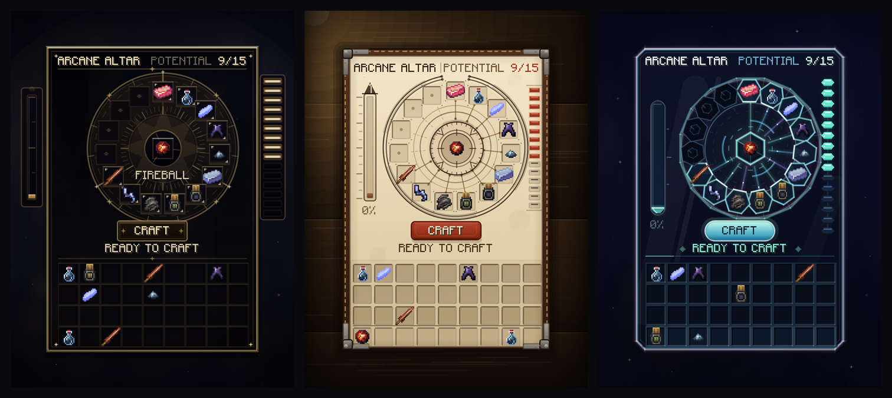

## 一、为什么重画

实机界面现在是三块各自为政的拼图：

| 问题 | 具体表现 |
|---|---|
| 三块硬拼 | 一块 176×256 灰蓝面板 ＋ **面板左外侧**一条彩虹进度竖条 ＋ **右外侧**一列 15 格势能条，三者没有共同的结构语言 |
| 看不出是机器 | 15 个材料槽就是 15 个灰方块按圆排一圈，没有刻度、没有朝向、没有"仪器"的读法 |
| 圆环互相打架 | 半径 70 的进度弧被标题和按钮切断（圆心 y=84，弧顶 y=14 已经压到标题行） |
| 垂直空间浪费 | 状态行塞在 y=168，和背包标题 y=172 抢同一条基线；面板 176×256 的上下都没用满 |
| 颜色没有主次 | 彩虹进度条是全图饱和度最高的东西，但它只表示"进度"；真正的主角（产物、按钮）反而最暗 |

三案的共同处方：

1. **只留一个焦点**：中心产物井 ＋ 那枚按钮。其余元素压到 20%~45% 不透明度。
2. **把外挂件收成机器的一部分**：进度柱 / 势能条不再是"贴在面板外的补丁"，
   而是同一台仪器的左右立柱（A）、页边批注（B）、仪表列（C）。
3. **15 个槽给它"朝向"**：A 是表盘刻痕、B 是纸面凹槽 + 墨辐条、C 是六边形晶格。

## 二、三案

### A · 星象仪（Astral Instrument）

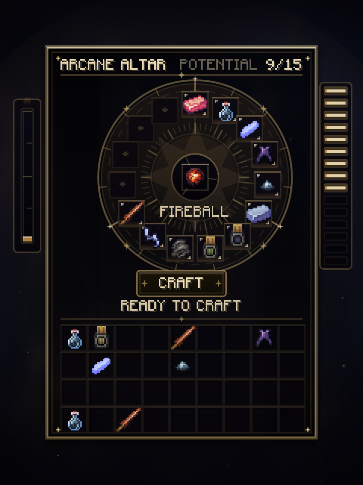

- 面板 = 嵌在暗色桌面上的**星图玻璃**：2px 黄铜包边、内侧 1px 细线、四角菱形铆钉、四周内暗角。
- 表盘 = 外圈细线 + 15 道外向刻痕（一道对一个槽，每 5 道加菱形方位点）+ 一圈缓慢反转的虚线环
  + 内圈 60 格细刻度 + 8 芒星雕刻底纹；**只有填了材料的槽才拉一根辐条到中心**。
- 进度 = 左侧铜架里的**水银柱**（0% 留一滴残液、5 档水线、合成中整柱自下而上填）
  ＋ 合成时表盘外侧再套一圈亮弧（含弧头光点）。
- 势能 = 右侧 15 枚**黄铜保险丝**（亮格是暖金芯 + 两端触点）。
- 按钮 = 黄铜铭牌（内侧第二道线 + 两端菱形），禁用态整块压暗。
- 读法：冷静、克制、天文仪器；配色只有旧金 + 暖白 + 一点琥珀。

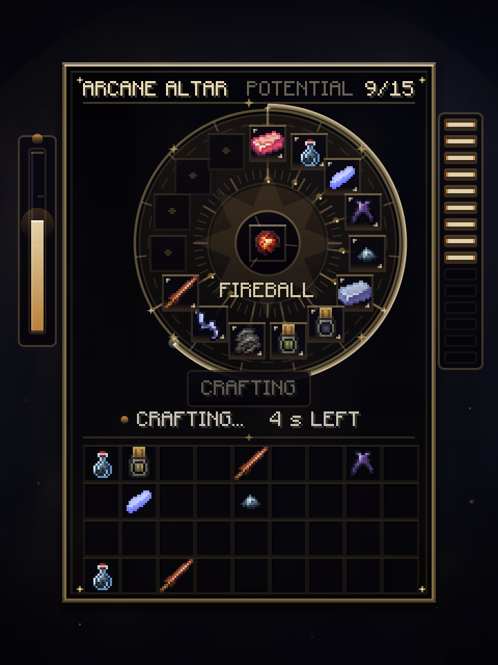

### B · 羊皮纸手稿（Grimoire Folio）

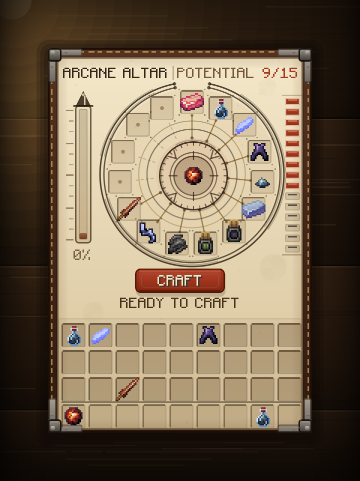

- 材质 = 羊皮纸书页：皮革包边 + 手缝针脚 + 铁包角，纸面有纤维墨点、茶渍与四边老化；
  纸片靠三层软阴影浮在暗木桌上，左上一点烛光。
- 法阵 = **手绘开口双圈**（正上方留口让出 0 号槽）+ 内圈 + 15 个纸面凹槽
  + 11 根赭墨辐条（实/虚两种笔触）+ 中心墨绘徽章（铸齿 + 三角 + 图标底托）。
- 进度 = 左侧**羽笔刻度柱**：0% 留槽底残墨，合成中自下而上染朱砂→赭金并报百分比。
- 势能 = 右侧 15 格**账簿印点**（亮格朱砂、灭格压暗）。
- 按钮 = **火漆印章**（就绪朱砂实心，合成中变灰墨虚章）。
- 读法：温暖、手作、抄本；只有朱砂与赭金两处彩度。

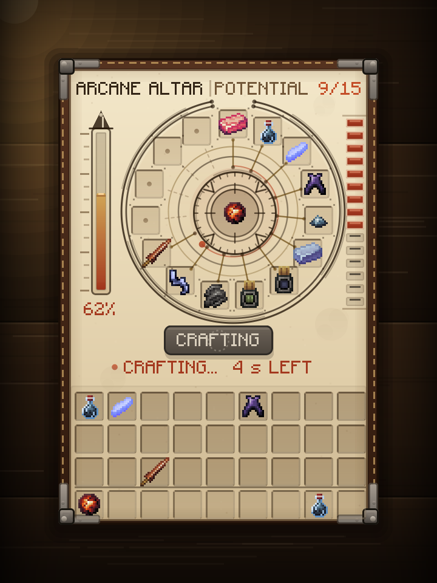

### C · 棱镜晶体（Prism Lattice）

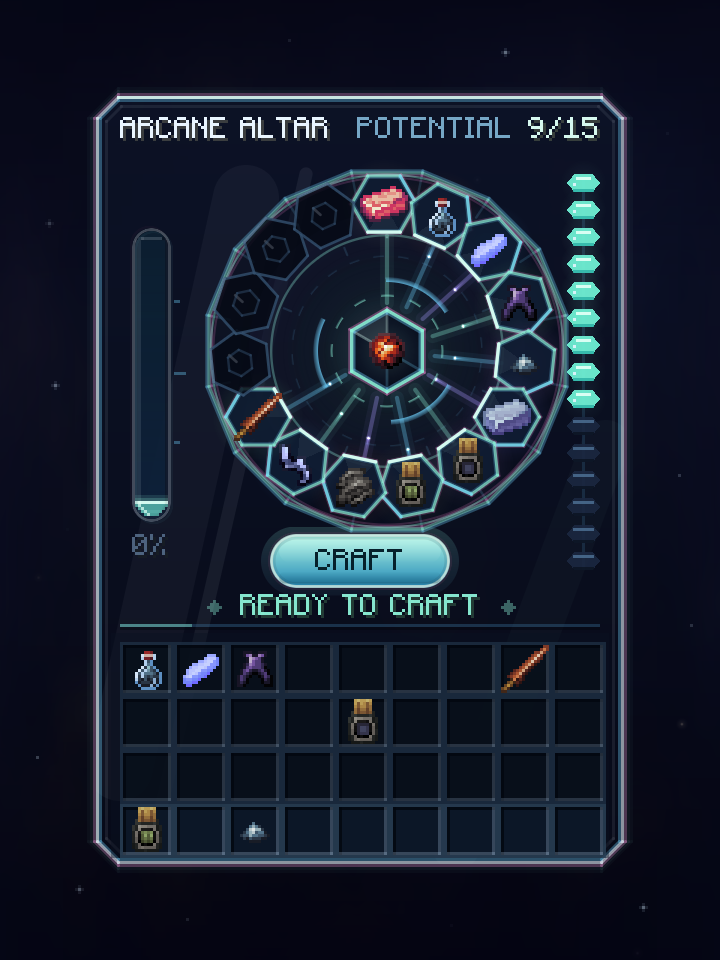

- 面板 = 半透深靛玻璃板：切角、边缘青/品红两圈 1px 错位描边做**色散**、板内两道斜向高光。
- 机器 = **十六边形晶盘** ＋ 15 个六边形晶体槽（切向正好相碰成一圈晶格）；
  已填槽有晶体底 + 左上亮棱面 + 学派色微光，空槽是暗玻璃 + 中心空巢。
- 能量 = 每个已填材料到核心一条真实 `magic_pulse` 梯形光带（薄荷/青/淡紫循环，
  底带 + 柔光 + 跑动光点）；核心是六面晶体 + 三段正转光栅 + 12 段反转短弧。
- 进度 = 左侧**液体光柱**（液面高光 + 上浮气泡）＋ 右侧读数。
- 势能 = 右侧 15 枚**水晶碎片**（9 亮 6 灭，亮的有呼吸光晕）。
- 按钮 = 玻璃胶囊（薄荷→青实心 + 色散描边，字用深靛反白）。
- 读法：科技感最强的一套，也是唯一"面板半透到能看见星场"的一套。

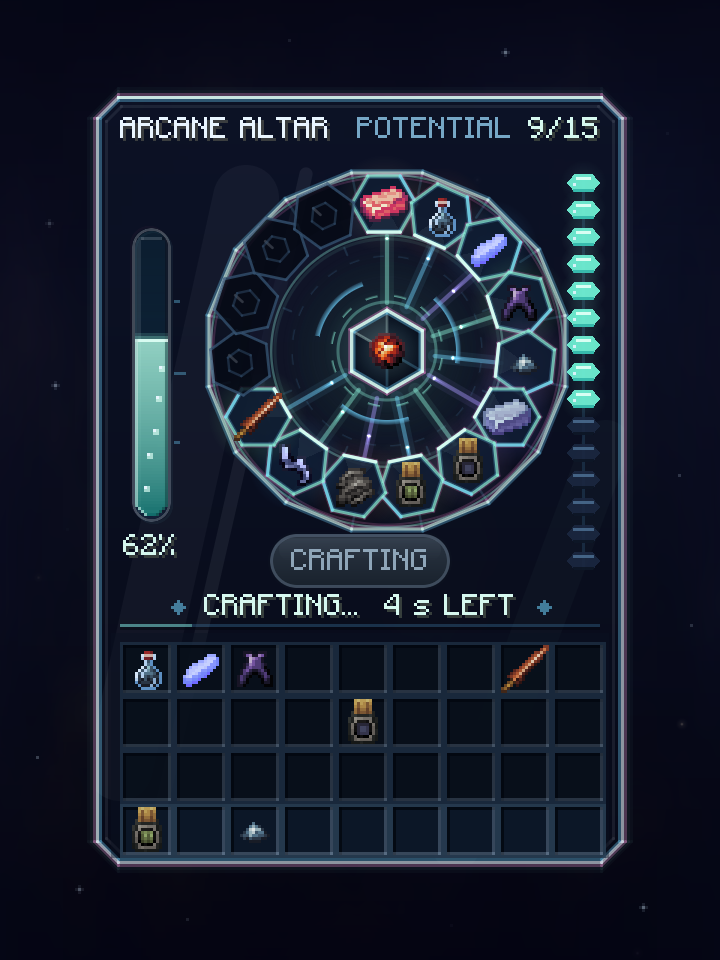

## 三、三案对照

| | A 星象仪 | B 羊皮纸手稿 | C 棱镜晶体 |
|---|---|---|---|
| 面板材质 | 暗星璃 + 黄铜包边 | 羊皮纸 + 皮革缝线 + 铁包角 | 半透靛玻璃 + 色散描边 |
| 机器的比喻 | 天文表盘 | 手绘法阵 | 六边形晶格 |
| 槽的形态 | 18×18 刻痕方槽 | 18×18 纸面凹槽 | 15 个六边形晶体槽 |
| 进度 | 水银柱 + 表盘亮弧 | 羽笔刻度柱 | 液体光柱 |
| 势能 | 15 枚保险丝 | 15 格账簿印点 | 15 枚水晶碎片 |
| 按钮 | 黄铜铭牌 | 火漆印章 | 玻璃胶囊 |
| 色度最高的东西 | 产物井 + 按钮 | 火漆 + 朱砂印点 | 能量带 + 核心 |
| 实机移植难度 | 低（全几何 + 2 支现成 shader） | 中（纸面/针脚需要 1 张贴图或程序化） | 中高（色散与晶体靠叠加，逐元素画） |

三案共用的取舍：

- **状态行统一挪到面板内 y=166 居中**，背包标题 `INVENTORY` 三案都删掉
  （实机是状态 y=168 / 标题 y=172 抢同一条基线）。
- **页眉统一一行**：`ARCANE ALTAR`（1x，左）+ `POTENTIAL 9/15`（右）。
  面板只有 176 宽，完整 `ARCANE INSTRUMENT ALTAR` + 读数塞不下，进游戏用 lang key。
- 势能读数在页眉、势能可视在右柱，两者同一竖轴。

## 四、不变的几何（三案逐像素一致，也不许改）

| 元素 | 数值（面板局部） | 来源 |
|---|---|---|
| 面板 | 176×256 | `PotentialCraftingMenu.IMAGE_WIDTH/HEIGHT` |
| 圆环中心 | (96, 84) | `RING_CENTER_X/Y` |
| 15 个材料槽 | 18×18，半径 48，角度 `-90 + i·24°` | `ringAngleDegrees` / `RING_RADIUS` |
| 圆心产物槽 | 18×18，左上 (88, 76) | 输出槽 |
| 按钮 | (58, 146, 60, 18) | `BUTTON_X/Y/WIDTH/HEIGHT` |
| 背包 | 3×9，槽 18×18，起点 (8, 182) | `PotentialCraftingMenu` |
| 快捷栏 | 9 格，起点 (8, 236) | 同上 |

也就是说这三案**都能 1:1 落到实机**：`PotentialCraftingScreen#updateRingLayout`、
`insideButton`、`canStart`、服务端校验一行都不用动，只换 `renderBg` / `renderLabels` 的画笔。

## 五、定稿方向：C 主体 + A 的两条读数条（形状 / 位置 / 颜色都照 A）

场景 `spell_altar_hybrid`，源码 `tools/gui-preview/SceneSpellAltarHybrid.java`。

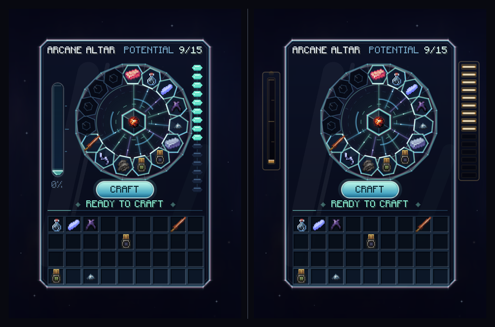

左 = C 原案（读数条收在面板内的薄荷光柱 + 水晶势能列）；
右 = 定稿（两条读数条挂到**面板外**，用 **A 案原件**）。

**从 C 拿的（主体）**：深靛蓝半透玻璃面板 + 品红/青 1px 错位色散描边、十六边形晶盘、
15 个六边形晶体槽、材料到核心的 `magic_pulse` 能量带 + 跑动光点、棱镜核与正反转光栅、
玻璃胶囊按钮、状态行菱形点、背包玻璃格 —— 这些绘制代码一行未改；
只**删掉**了 C 原本放在面板内的两条读数条（液体光柱、水晶势能列），由 A 案的两条替上。

**从 A 拿的（两条读数条 = `SceneSpellAltarAstral#mercury/fuses` 逐字符照搬）**：

| | 位置（面板局部） | 形状（全部 A 案原始数值） |
|---|---|---|
| 左：进度柱 | `x=-22, y=36, 16×96`（面板**外**左侧） | 外框 `(x-1.5,y-3,19,102,r3)` α92；玻璃管 `(x+3.5,y+3,9,90,r2)` α58；液柱 `x+5 / 宽 6 / y+5 / 高 86`；0% 留 **3px** 残液；5 档横贯水线（inset 0/3，α78/44）；管壁 1 根反光；指示灯 `(x+8,y-1,r2.6)` |
| 右：势能保险丝 | `x=182, y=25`，15 格 `16×6`、间隔 2（面板**外**右侧） | 底板 `(x-3,y-3,22,totalH+6,r3)` α92；每格 `(x,py,16,6,r1.2)`；亮格底 α150/90、边 α70，亮芯 `(x+2,py+2,12,2)` α225 + 两端 1px 接线柱 α200；灭格边 α34；合成中整排外圈呼吸（α70·pulse） |

**颜色也照 A**：读数条保留黄铜 / 水银金 / 琥珀。
「颜色统一到 C」只做在**面板与机器**上 —— 两条柱子挂在框外，本来就是"另外两件仪器"，
一旦染成同族青色，就会和面板那圈 1px 色散描边糊在一起，"在框外"这个结构信息直接消失
（这一版之前正是这么翻车的）。

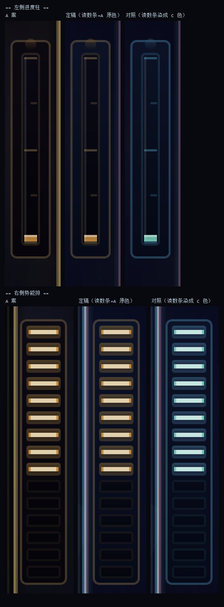

### 为什么"单看柱子对、看整图发青"（已修）

A 案的柱体是**半透明**的：外框 α240、玻璃管 α192。在 A 案里它压在暖色桌面上，
透出来的底色是暖的；搬到 C 案的靛蓝星场上之后，同一份像素会透进 25% 的蓝底，
再加上柱子和面板那圈青色描边只隔 3px，1:1 看整图时就会读成"发青"。
像素抽样可以证明柱子本身没变：

| 取样点 | A 案 | 定稿（同一份代码） |
|---|---|---|
| 右排亮芯 | `RGB(224,208,172)` | `RGB(225,209,173)` |
| 右排底板边 | `RGB(67,57,45)` | `RGB(66,61,56)` |
| 合成帧柱内最亮像素 | `RGB(247,236,218)` | `RGB(247,236,218)` |

修法不是改柱子的颜色（那就不是 A 案了），而是给它补一块 A 案里本来就有的**暖色底板**
（`gaugeMount`：不透光的暗木色圆角块 + 1px 暖金细边），柱子的合成底色因此回到 A 案的暖调，
也和面板之间有了明确的物理边界。想回到"完全半透明的 A 案柱体"，把 `GAUGE_MOUNT` 设成
`false` 即可。

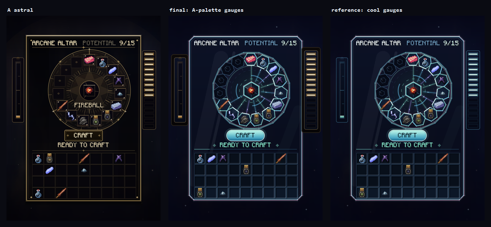

上图三列是同一画布坐标裁的：第 2 列（定稿）与第 1 列（A 案）几乎是同一张图，
第 3 列是**对照实验**（两帧 `_tinted_*`，把柱体染成 C 色）——几何完全一样，只换色相。

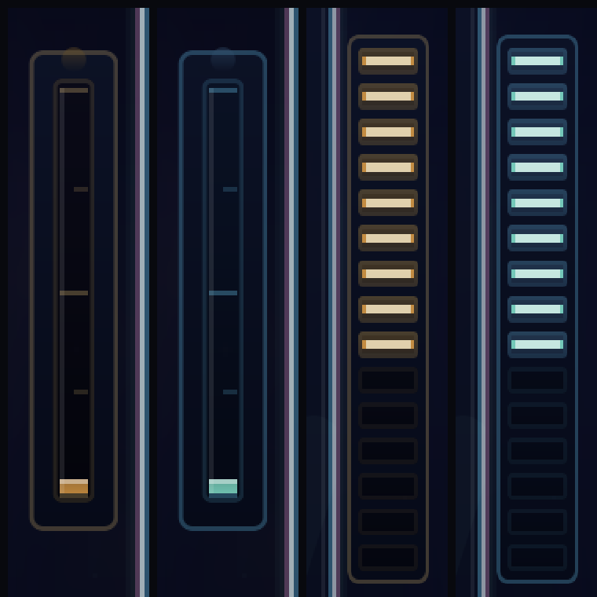

### 怎么确认没有"导出坏了"

| 检查 | 方法 | 结果 |
|---|---|---|
| 文件是否陈旧 | `docs/previews/spell_altar_hybrid.png` 与 `build/gui-preview/spell_altar_hybrid_ready.png` 比 SHA256 | 完全相同 |
| 几何是否一致 | 逐行统计右排"亮芯"所在的画布行号（A vs 定稿） | 59-61 / 67-69 / 75-77 / 83-85 / 91-93 / 99-101 / 107-109 / 115-117 / 123-125，**完全相同**（正好 9 格） |
| 画法是否一致 | 两个场景的 `mercury()` / `fuses()` 方法体去注释、去颜色后逐字符比较 | **完全相同**（1030 / 659 字符） |
| 亮灭对比是否一致 | 每格平均亮度（A / 定稿-冷色版） | 93/93/…/10（9 亮 6 灭） vs 98/97/…/15，结构一致；冷色版曾因 `GOLD_LO→C_CYAN_LO` 偏亮 28 级而整格发蓝，现已改成按亮度对齐的 `C_CELL_EDGE` |

**刻意不加的东西**（加了就不算 A 案，已全部删除）：

- 柱下的 `0% / 62%` 百分比读数 —— A 案不写字，进度只靠液面高度与 5 档水线读；
- 柱体底部基座、管外短刻度、第二根玻璃反光、液面第二/三行柔光；
- 保险丝每格的单枚呼吸光晕；
- 面板内左右两根"挂轨"（A/C 都没有）。代码里保留成 `MOUNT_RAILS`，**默认关**。

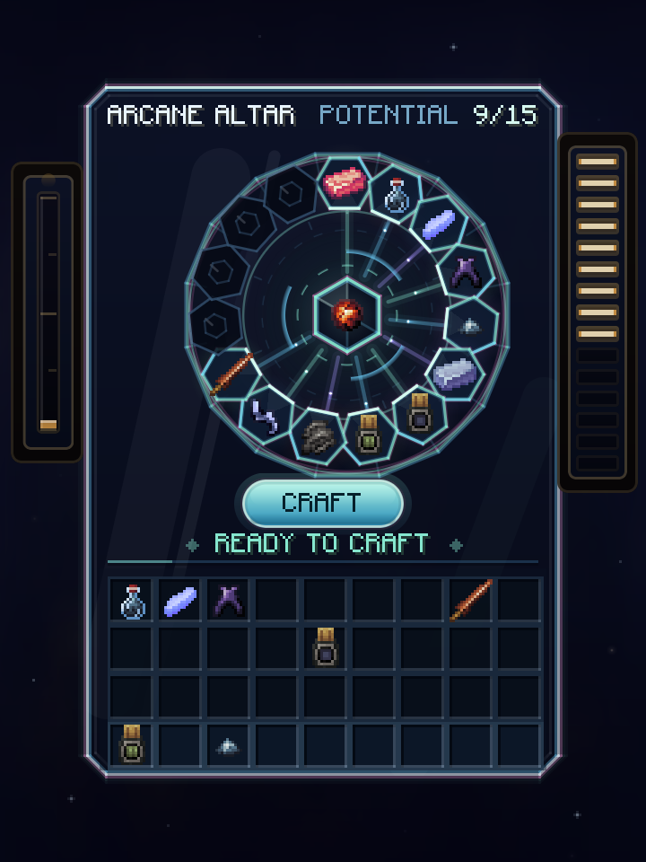

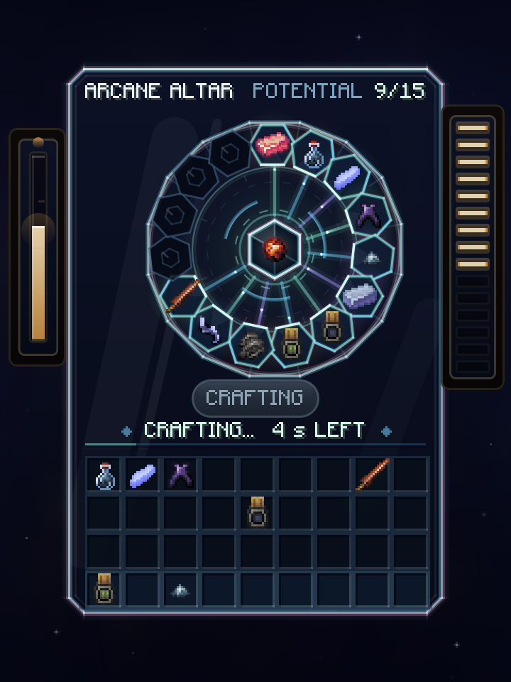

## 六、复现

```powershell
cmd /c "tools\gui-preview\gui_preview.cmd -Scene spell_altar_astral   -Time 2.4 -Width 240 -Height 320 -Scale 3"
cmd /c "tools\gui-preview\gui_preview.cmd -Scene spell_altar_grimoire -Time 2.4 -Width 240 -Height 320 -Scale 3"
cmd /c "tools\gui-preview\gui_preview.cmd -Scene spell_altar_prism    -Time 2.4 -Width 240 -Height 320 -Scale 3"
cmd /c "tools\gui-preview\gui_preview.cmd -Scene spell_altar_hybrid   -Time 2.4 -Width 240 -Height 320 -Scale 3"
```

- 逻辑画布 240×320、`-Scale 3` → 720×960 PNG（= GUI scale 3 的观感）
- 每案导出 `<scene>_ready.png` / `<scene>_crafting.png`，以及默认导出的 `<scene>.png`
- 场景源码：`tools/gui-preview/SceneSpellAltarAstral.java` /
  `SceneSpellAltarGrimoire.java` / `SceneSpellAltarPrism.java` / `SceneSpellAltarHybrid.java`
  （每个都是单文件，没动框架与脚本）

## 七、边界（这些图**不是**实机截图）

- 是设计稿：交互是静态模拟，没有 hover / 点击反馈帧，也没有 tooltip。
- 只有英文文案：预览工具的 MC 位图字体只带拉丁字形，进游戏必须走 lang key。
- 图标是现有物品贴图占位（11 个材料用 `fire_mana_plate` / `mana_bottle` / `domite_crystal`… 顶替），
  数值状态固定为「11/15 材料、势能 9/15、Fireball」这一组。
- 圆/环/扇形/圆角全部走 `sdf_ui`（逐物理像素覆盖率），但**实机阴影、光影包、GUI scale 4** 未验证。
- 面板 176×256 在 1920×1080 @ GUI scale 3 下（逻辑 640×360）放得下；scale 4 需要另做等比缩放。
- B 案的纸面/针脚、C 案的色散与晶体底都靠大量 1px 叠加，实机每帧代价要重新量一遍
## 八、实装记录（已落地）

已按本稿重写实机界面：`src/main/java/org/bytechen/rottenruins/client/gui/PotentialCraftingScreen.java`。

**只换了画笔**：命中框、15 个槽位坐标、按钮矩形 (58,146,60,18)、背包 (8,182)/快捷栏 (8,236)
全部仍在 `PotentialCraftingMenu` 里；`updateRingLayout()` 的自转+收拢动画数值与旧版逐字一致，
槽框跟着每帧写入的 `slot.x/y` 画，所以合成动画的观感不变。

| 设计稿元素 | 实机实现 |
|---|---|
| 面板切角玻璃 + 品红/青错位描边 | `panel()` / `chromaticEdge()`：切角逐行收边 + 三圈 1px 描边 |
| 十六边形晶盘 + 六边形晶格槽 | `machine()` / `slots()`：SDF 正多边形（`uMode = 4`），填充与 1px 内描边各一个 quad |
| 材料→核心能量带 + 跑动光点 | `machine()`：SDF 胶囊线段 + 圆点，光点沿带跑动 |
| 左进度柱 / 右势能排（A 案原画法） | `gaugeShells()`（SDF 圆角/圆点）+ `gaugeInteriors()`（原版填充液体与灯丝）；底下多一层 `mountPlates()` 暖色底板 |
| 深空底 + 暗角 | `background()`，调用项目真实的 `MagicGuiShaders.drawStarfield`，失败退回纯色 |
| 文案 | 仍走 `gui.rotten_ruins.potential_crafting.*` 与方块名 lang key；删掉 `INVENTORY` 字标，状态行独占 y=166 |

**抗锯齿：曲线与斜线全部走 SDF**：

1. 圆、圆环、圆角矩形、胶囊线段、正多边形（六边形晶格槽 / 十六边形晶盘）全部走项目已有的
   `sdf_ui`（`SplendidingShaders.wheelSdfShader`），入口是 `client/rend/gui/WheelGuiShaders`；
   `uScale = GUI scale`，边界永远是 1 个物理像素的过渡。
2. 为这版给 `sdf_ui` 加了 **`uMode = 4` 正多边形**（`sdRegularPolygon`：按"到最近边法线"的距离，
   支持等宽内描边），并给 `WheelGuiShaders` 加了 `sdfBegin()/sdfEnd()` 批量与 `sdfPolygon()` ——
   一帧几十个形状只 flush / 切程序一次。
3. 只有 1px 硬边（面板切角、发丝线、分隔线、背包格、槽内细线）仍用 `GuiGraphics.fill`，
   保持 MC 的像素风；着色器加载失败时自动退回扫描线绘制，界面仍可用。
4. 星场由 `magic_starfield` 真实着色器绘制；着色器缺失时整屏退回 `0xFF05030E`。
5. 画布换成本屏幕真实的 176×256 面板（+ 面板外的两条读数条）。

**架构门禁**：`client/gui/PotentialCraftingScreen` 的 `@OnlyIn(Dist.CLIENT)` 在
`tools/architecture/reviewed-coupling.txt` 里补了两条 `client-forge` 边并写明侧入口
（界面只在 `ClientModEventHandler` 的客户端屏幕注册里构造），没有放宽任何检查。
`WheelGuiShaders` 与界面同属 `client` 层，不新增耦合边。

**验证边界**：依赖检查、编译、jar 打包通过；**实机视觉未验收**（按项目约定由你验收）。
落地后若某处间距/亮度不合适，改 `PotentialCraftingScreen` 顶部的常量与配色即可，其它文件不用动。