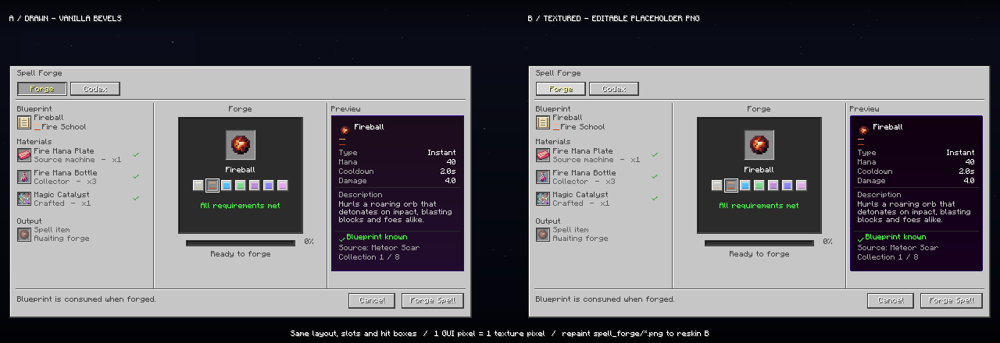

# 法术合台 GUI：两套 Minecraft 风格提案

按"先看原版风格、再决定美术"的要求，法术合台给出两套共享同一布局的方案：

- **方案 A / DRAWN**：不新增贴图，全部用 `GuiGraphics.fill` 绘制原版容器的 1px 斜角、槽位井、灰色按钮。
- **方案 B / TEXTURED**：静态底板来自占位 PNG，文字、物品图标、进度、选中态仍由运行时叠加；美术后续直接重绘 PNG 即可换肤。



两套方案几何完全一致（同一张图里除了按钮/底板的实现外，坐标、槽位、命中区域完全相同）。
早期金色星空版视觉稿仍保留在 `tools/gui-preview/SceneSpellForge.java`，本提案是转向原版风格后的版本。

## 布局

640×400 逻辑画布（1280×800 @ GUI scale 2），面板 592×324 位于 (24,44)。
下表坐标相对面板左上角，1 GUI 像素：

| 区域 | x / y / w / h |
|---|---|
| 标题 `Spell Forge` | 10 / 6 |
| Forge / Codex 页签 | 10 / 21 与 78 / 21，各 64×18 |
| 标题分隔线 | y = 43（深）/ 44（亮） |
| Blueprint 槽 | 10 / 64，18×18 |
| 材料槽 ×3 | 10 / 106、134、162，18×18 |
| Output 槽 | 10 / 208，18×18 |
| 熔炉窗口 | 216 / 66，160×150 |
| 产物槽 | 276 / 82，40×40 |
| 七学派按钮 | 首个 234 / 146，16×16，间距 2 |
| 进度槽 | 226 / 224，140×8 |
| 法术预览 tooltip | 412 / 64，170×200 |
| 底部分隔线 | y = 286（深）/ 287（亮） |
| Cancel / Forge 按钮 | 434 / 292 60×20，502 / 292 80×20 |
| Codex 卡片 | 首张 10 / 56，132×98，列距 144、行距 110 |
| Codex 底部按钮 | 502 / 292，80×20 |

所有文字用 MC 位图字体 1x；物品图标 16×16 原尺寸；只有这两类内容是"像素风"，其余装饰全部是硬边 1px。

## 方案 A：纯绘制原版风格

- 不透明 `#C6C6C6` 底板，1px 深色外框；上/左亮边、下/右暗边。
- 槽位是 18×18 的凹陷井（`#8B8B8B` 面 + 1px 内阴影），16×16 物品图标直接落在井里。
- 按钮用 20px 级斜角；按下页签为凹陷 + 黄字。
- 熔炉窗口是深色凹陷面板；学派选择是"凸起小方钮 + 8×8 学派色块"，选中时凹陷并加 1px 白框。
- 右侧预览是原版 tooltip 配色（紫黑渐变 + 蓝色描边）；描述和数值都是运行时文本。
- 蓝图卷轴、对勾、锁是 16×16 / 8×8 的代码像素画，同样由 `fill` 绘制。
- **落地方式**：把这些 `fill` 调用搬进实机 `Screen#render`；不需要任何新资源，但后续美术定制要改 Java。

## 方案 B：程序生成占位 PNG，再由美术重绘

**游戏实际读取的纹理目录：`src/main/resources/assets/rotten_ruins/textures/gui/spell_forge/`。后续请直接修改此目录中的 PNG。**

与方案 A 的观感一致；区别是外壳、槽位、窗口、tooltip 框、卡片背景和图标都来自 PNG。
文字、物品图标、进度条填充和"选中/悬停"等状态**没有烘焙进底板**，仍由代码叠加。
按钮和页签走 20×20 状态图集的九宫格（四边各固定 2px），任意宽度都能复用。

### 可重绘资源

| 文件 | 尺寸 | 内容 |
|---|---|---|
| `forge.png` | 592×324 | 外壳、标题/列/底部分隔线、5 个槽位井、熔炉窗口、产物槽、进度槽、预览 tooltip 框 |
| `codex.png` | 592×324 | 外壳、标题/底部分隔线（Codex 页不画列分隔线） |
| `cards.png` | 264×98 | 已知卡 (0,0,132,98)、未知卡 (132,0,132,98) |
| `widgets.png` | 112×20 | 4 个 20×20 按钮态、16×16 卷轴、8×8 对勾、8×8 锁 |

`widgets.png` 左闭右开区间：

| 区域 | x / y / w / h | 用途 |
|---|---|---|
| 常态按钮 | 0 / 0 / 20 / 20 | 普通按钮、未选中页签 |
| 悬停按钮 | 20 / 0 / 20 / 20 | hover |
| 按下/选中 | 40 / 0 / 20 / 20 | 选中页签、按下态 |
| 禁用按钮 | 60 / 0 / 20 / 20 | 刻录中的 Forge 按钮 |
| 蓝图卷轴 | 80 / 0 / 16 / 16 | Blueprint 槽图标 |
| 对勾 | 96 / 0 / 8 / 8 | 材料齐备、蓝图已知 |
| 锁 | 104 / 0 / 8 / 8 | 未知法术卡 |

生成器同时把同一套图写到 `docs/proposals/spell-forge/textures/` 作为可再生成的备份：

```powershell
python tools/generate-spell-forge-gui-placeholders.py
```

生成器默认同时覆盖正式资源和提案备份；**美术重绘之后不要再运行生成器**（会覆盖正式资源），只跑预览命令即可看到改图效果。

## 复现预览

```powershell
# 6 张独立预览（A/B 各：就绪 / 刻录中 / Codex）
cmd /c "tools\gui-preview\gui_preview.cmd -Scene spell_forge_styles -Time 2.4"

# 1280×440 并排对比图
cmd /c "tools\gui-preview\gui_preview.cmd -Scene spell_forge_styles -Time 2.4 -Width 1280 -Height 440 -Scale 1 -OutDir docs\proposals\spell-forge\previews"
```

场景：`tools/gui-preview/SceneSpellForgeStyles.java`；生成器：`tools/generate-spell-forge-gui-placeholders.py`。

## 说明与边界

- 法术数值取自实机 `SpellDefinition`（Fireball 40 蓝 / 2.0s / 4.0 伤害 / INSTANT；Tidal Pulse、Arcane Step 用于图鉴已知卡）。
- 蓝图/残页物品与"已发现"进度目前游戏里还不存在，界面是设计稿；未知卡是留白占位。
- 预览文字用英文，因为 GUI 预览工具的 MC 位图字体只覆盖拉丁字符。
- 尚未接入实机 `Screen`，也未验证真实鼠标/键盘交互与窗口缩放；布局、贴图切片的数值以本文件为准。
