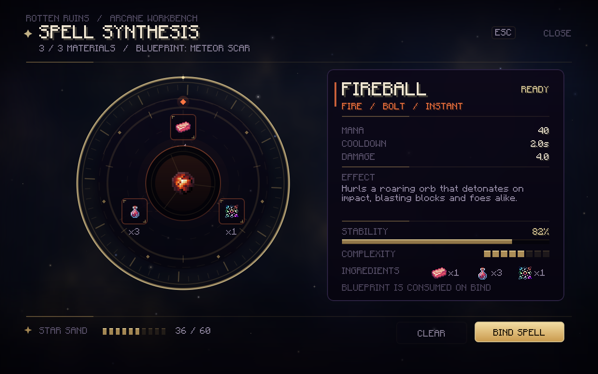
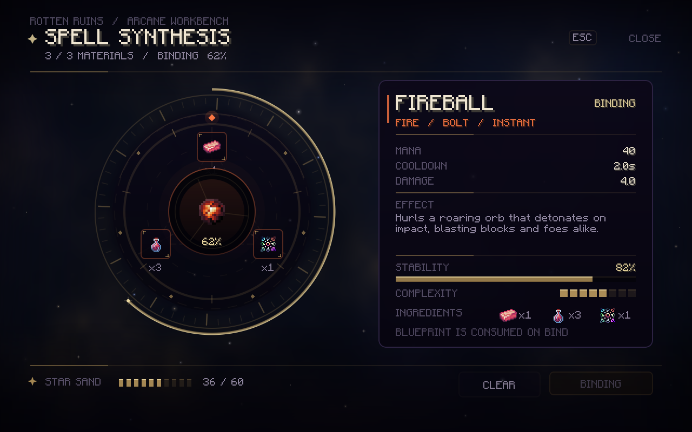
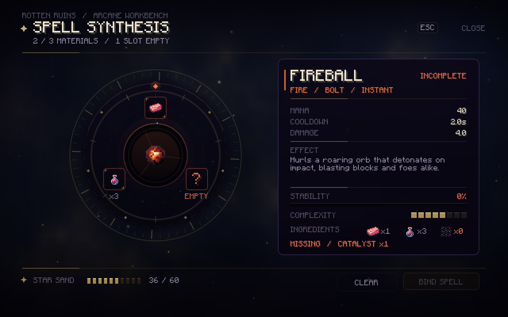

# 法术合成界面：仪式环（新视觉稿）

一版整体重做的合成界面，用项目自己的 GUI 预览工具出图。和之前两代提案
（[`spell-forge`](../spell-forge/README.md) 材料清单、[`spell-weave`](../spell-weave/README.md) 画星座）
不是同一套构图，是直接换思路。



## 为什么另起一版

旧稿的三个问题：灰底容器把界面压成一张表单；七个学派的彩色分区铺在环上太花；
"面板里再套面板"让眼睛没有落点。这一版只做三件事：

1. **整屏构图，不要外框**。界面直接浮在星场上（项目真实 `magic_starfield`），
   只用一根发丝线分隔头和身体，不再画一个大灰框把内容装起来。
2. **全屏只有一个高亮**：中心法术（32×32 图标 + 暖光井）和右下实金按钮。
   其余元素一律压到 20%~40% 不透明度；七学派只保留**当前学派**一处上色，
   其余六格是统一的金色刻痕。
3. **左侧是仪器，右侧是读数**。左边仪式环负责"操作"，右边一张深色圆角卡负责
   "结果"（耗蓝 / 冷却 / 伤害 / 效果 / 稳定性 / 复杂度 / 材料），两块之间只靠
   空白和留白分开，没有第三条分割线。

## 结构

| 区域 | 内容 |
|---|---|
| 页眉 | 小字标 + `SPELL SYNTHESIS`（2x）+ 状态副标题；右侧 `ESC` 键标 |
| 左：仪式环 | 表盘面（径向渐隐）→ 60 格刻度 → 反向虚线环 → 七学派刻度环（激活色标记）→ 三颗材料星（120° 均分，虚线弦连成三角）→ 中心法术井 |
| 右：结果卡 | 学派色竖条 + 法术名 2x + 学派/形态/施法类型；三行数值；效果句；稳定性条；复杂度刻度；材料清单 |
| 页脚 | 星砂刻度（10 格）+ `CLEAR` / `BIND SPELL` |

三种状态：`ready`（可绑定）、`binding`（进度弧沿外环跑 + 井内百分比）、
`missing`（空槽显示 `?`/`EMPTY`、卡片转 `INCOMPLETE`、绑定按钮禁用）。





## 放大与分辨率

- 画布 640×400 逻辑像素（= 1280×800 窗口 @ GUI scale 2），所有坐标写成
  `CX / CY / R_*` 常量，改一处就能整体缩放。
- 圆、环、扇形、圆角矩形、胶囊线全部走 `sdf_ui`（逐物理像素覆盖率），
  任意 GUI scale 下边缘都干净；刻度、文字、边框保持 1px 硬边。
- 星场与势流走项目真实 `magic_starfield` / `magic_pulse`；着色器缺失时
  `SdfShapes` 会退化为 CPU 多边形，界面仍成立。

## 复现

```powershell
cmd /c "tools\gui-preview\gui_preview.cmd -Scene spell_synth -Time 2.4"
```

产物：`build/gui-preview/spell_synth_ready.png`、`spell_synth_binding.png`、
`spell_synth_missing.png`，以及默认导出的 `spell_synth.png`（= 就绪态）。
场景源码：`tools/gui-preview/SceneSpellSynth.java`（单文件，不改框架与脚本）。

## 边界

- 这是**设计稿**：没有 `Screen` / `Menu` / 网络包，交互是静态模拟；
  按钮、材料星的可点击区域尚未落地成命中框。
- 640×400 是固定画布。实机在 1920×1080 @ scale 3 下只有 640×360 逻辑高度，
  落地时必须先做"按可用高度等比缩放"，不能照搬常量。
- 数值取自实机 `SpellDefinition`（Fireball：40 蓝 / 40 ticks / 4.0 伤害 / `IMMEDIATELY`），
  但工具侧是手抄字面量，不改实机数据。
- 文案全英文：预览工具只带 MC 拉丁位图字体；进游戏后应走 lang key。
