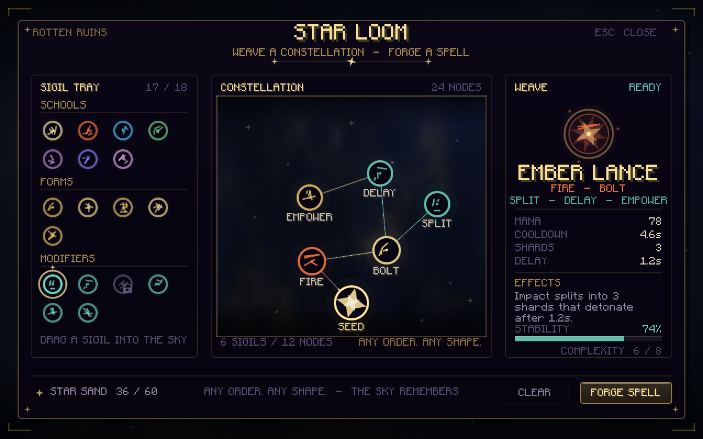
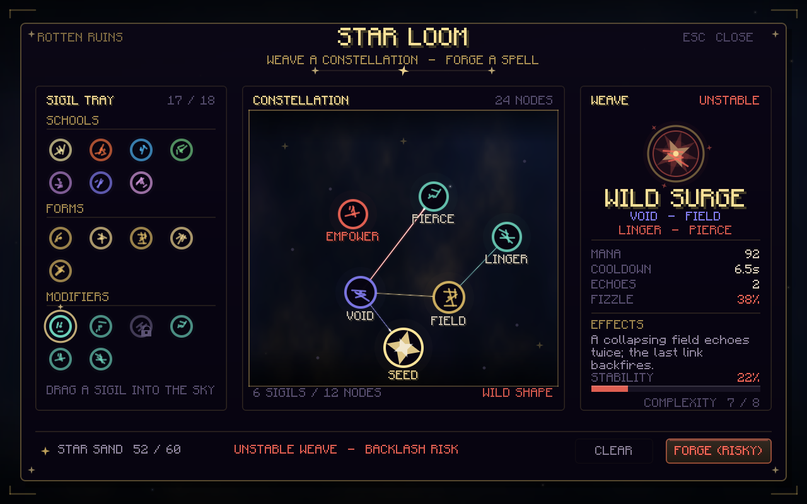
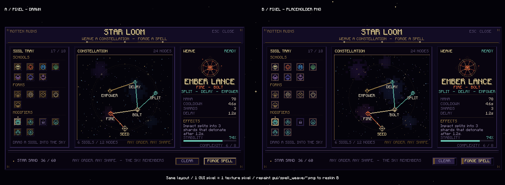
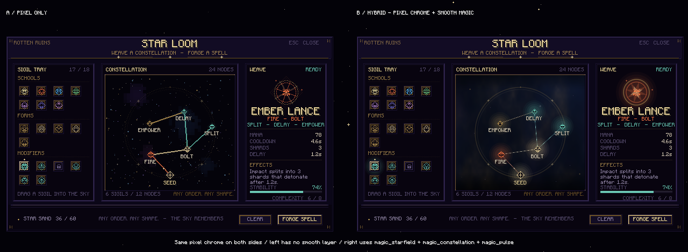

# 织星台（Star Loom）：更自由的施法合成概念

针对"合成方式不够自由、界面不够魔法"的反馈，这版把合成从**材料清单**改成**画星座**：
符印是可重复使用的知识，玩家在夜空里把符印拖成星点、把星点连成星座，连出来的形状就是一个法术。
唯一的消耗是一种燃料（星砂 / 势能），不再摆 3 个材料槽。





这是设计稿（未接入实机 Screen），用于先确认交互和视觉方向。

## 像素美术 A/B（当前主推）

"原版风格"不等于原版灰色和原版贴图：像素 UI 也算。所以织星台再出一对像素方案，
共用同一布局和交互，只是"静态外观从哪来"不同：



| | 方案 A / PIXEL - DRAWN | 方案 B / PIXEL - PLACEHOLDER PNG |
|---|---|---|
| 静态底板 | Java `fill` 逐像素画 | `weave_bg.png` |
| 星空 | 6×6 点阵星云 + 像素星点 | `sky.png` |
| 按钮 / 符印框 | 代码画 1px 斜角 | `widgets.png` 图集 |
| 文字 / 符文 / 星座 / 法阵徽记 / 进度 | 运行时叠加 | 运行时叠加 |
| 美术定制 | 改 Java | **改 PNG 即可** |

配色不用原版灰，而是暗靛 + 金 + 紫 / 青的星术盘；所有装饰都是 1px 硬边、点阵抖动和像素符文。
两套的几何、槽位、命中区域完全一致，切换只取决于"静态外观是画出来还是贴出来"。

**正式资源目录：`src/main/resources/assets/rotten_ruins/textures/gui/spell_weave/`。**
生成器：`tools/generate-spell-weave-gui-placeholders.py`（同时写提案备份和正式资源；
**重绘后不要再跑生成器**，会覆盖正式资源）。

| 文件 | 尺寸 | 内容 |
|---|---|---|
| `weave_bg.png` | 608×364 | 面板、标题带、三个凹陷分区、底栏、四角符文 |
| `sky.png` | 244×218 | 星云 / 星点 / 淡法阵环 / 内框；贴在面板相对 (182,70) |
| `widgets.png` | 160×20 | 按钮四态 20×20（0/20/40/60）+ 符印框三态 20×20（80/100/120）+ 7×7 锁 |

按钮和符印框的九宫格固定 2px 边；符印内的符文、星座连线、法阵徽记、文字和进度条都由运行时绘制，
所以重绘底板不会把动态内容画死。

复现：

```powershell
python tools/generate-spell-weave-gui-placeholders.py
cmd /c "tools\gui-preview\gui_preview.cmd -Scene spell_weave_styles -Time 2.4"

# 1280×470 并排对比
cmd /c "tools\gui-preview\gui_preview.cmd -Scene spell_weave_styles -Time 2.4 -Width 1280 -Height 470 -Scale 1 -OutDir docs\proposals\spell-weave\previews"
```

A 的产物：`spell_weave_a_pixel.png`、`spell_weave_a_pixel_unstable.png`；
B 的产物：`spell_weave_b_tex.png`、`spell_weave_b_tex_unstable.png`。
上一版平滑 SDF / 发光着色器的版本（`SceneSpellWeave.java`）保留作"高氛围稿"对照。

## 混合渲染（当前主推）



原则：**结构 / 文字 / 交互件用像素，能量 / 氛围 / 反馈用平滑。**
像素层保证 MC 原生可读性、可贴图、可重绘；平滑层只负责"魔法在流动"。

| 部分 | 用哪种 | 理由 |
|---|---|---|
| 面板 / 边框 / 凹陷分区 / 角饰 | 像素 | 撑住结构，可贴图化 |
| 文字 / 数字 / 标签 | 像素 | MC 位图字必须清晰 |
| 按钮 / 页签 / 槽位 / 符印框 / 锁 | 像素 | 可点击件要一眼看清；B 方案可直接换 PNG |
| 进度槽 / 轨道 | 像素 | 结构件 |
| 夜空 / 星云 | 平滑 | `magic_starfield`，魔法氛围 |
| 星座连线 | 平滑 | `magic_constellation` 光带；1px 折线会锯齿 |
| 沿线光点 | 平滑 | `magic_pulse` 做"势流" |
| 星点辉光 | 平滑 | SDF 柔光；节点骨架 / 符文仍是像素 |
| 法阵徽记 / 光晕 | 平滑 | 能量感 |
| 选中符印 / 悬停 | 平滑（轻） | 只有状态高亮加光，托盘本身保持像素 |
| 不稳定红线 / 反噬 | 平滑 | 警示用"能量"表达；文字仍像素 |

**图层顺序**（代码里也是这个顺序）：

1. 像素底板（面板、分区、按钮、文字之前的所有结构）；
2. `pushClip` 到星座板内部的平滑星空；
3. 加色混合的连线 / 光脉冲 / 辉光；
4. 像素骨架（节点环、符文、图标、进度槽）；
5. 最上层文字与可点击件。平滑层永远不压文字和按钮。

**实现注意**

- 平滑层复用项目已有 GUI 着色器（`magic_starfield` / `magic_constellation` / `magic_pulse`）+ SDF；
  SDF 的抗锯齿宽度按 GUI scale 传入。
- 加色混合只给能量层；画完平滑层后恢复普通 alpha 混合，避免漏到像素层。
- 平滑层只覆盖星座板 / 徽记等小区域，不做全屏模糊；辉光层数固定，控制 GUI 开销。
- 着色器不可用时回退为纯像素版（上一节 A 方案），布局和交互不变。
- B 的可重绘 PNG 只覆盖像素层；平滑层随 shader 参数变化，不需要美术重绘。

复现：

```powershell
cmd /c "tools\gui-preview\gui_preview.cmd -Scene spell_weave_hybrid -Time 2.4"

# 1280×470 纯像素 / 混合对比
cmd /c "tools\gui-preview\gui_preview.cmd -Scene spell_weave_hybrid -Time 2.4 -Width 1280 -Height 470 -Scale 1 -OutDir docs\proposals\spell-weave\previews"
```

产物：`spell_weave_hybrid.png`、`spell_weave_hybrid_unstable.png`、`spell_weave_hybrid_compare.png`。
场景：`tools/gui-preview/SceneSpellWeaveHybrid.java`。

## 为什么要换一种合成方式

| 旧方案（材料清单） | 新方案（织星台） |
|---|---|
| 配方是隐藏的，玩家只能猜"还差哪个材料" | 组合空间公开，玩家可以**主动设计**法术 |
| 每次合成都消耗一套材料，试错成本高 | 符印是知识（不消耗），只有燃料 + 复杂度成本 |
| 界面是"槽位 + 进度条"，魔法只停留在贴图上 | 交互本身就是施法的一部分：画星图、跑势流、看推演 |
| 法术数量 = 内容量，加法术只能加配方 | 少量符印 × 组合规则 = 大量可能，内容可扩展 |

## 交互规则（本稿采用）

### 符印（可复用）

| 类别 | 作用 | 本稿示例 |
|---|---|---|
| 学派 | 决定元素、状态、配色 | 光 / 火 / 水 / 自然 / 死亡 / 虚空 / 神秘 |
| 形态 | 决定法术的主行为 | BOLT 弹 / BEAM 束 / FIELD 场 / AURA 环 / STEP 步 |
| 修饰 | 叠在形态上的行为 | SPLIT 分裂 / DELAY 延迟 / CHAIN 连锁 / PIERCE 穿刺 / EMPOWER 强化 / LINGER 残留 |

符印通过世界内容解锁（Boss、遗迹、源荷异常），未发现的只显示暗色锁钮；使用不消耗，
所以玩家可以反复实验，而不是"背配方攒材料"。

### 星座规则

- 从 **SEED（核心）** 出发，把符印星拖到夜空格点上并连线，形成一条或数条路径。
- **顺序** = 结算优先级：先形态后学派还是先学派后形态，会影响"先聚能再决定元素"之类的细节。
- **分叉** = 并行 / 分裂：一个节点连出两条支路，对应多目标/分裂。
- **闭环** = 回响 / 维持：把路径连回自身附近，产生延迟回响或持续场。
- 复杂度有上限（本稿 8），稳定性由组合冲突决定；稳定性低不会"扣材料失败"，而是让法术
  变狂野（反噬、随机目标、双倍耗蓝）——保留试错的乐趣。
- 输出物是一个**织法法术**：`星座图`（节点 + 连线 + 修饰）序列化进物品 NBT，
  可进魔法池 / 轮盘；也可以存成"图案卡"重复织造或分享给其他玩家。

### 界面分区

| 区域 | 内容 |
|---|---|
| 左：SIGIL TRAY | 可复用符印，按学派 / 形态 / 修饰分组；锁定的显示暗色 |
| 中：CONSTELLATION | 夜空黑板：星点、连线、沿星图流动的势流光点；底部显示已用节点 |
| 右：WEAVE | 实时推演：生成的法术名、耗蓝 / 冷却 / 伤害、效果句子、稳定性、复杂度 |
| 底：燃料行 | 星砂（或源荷势能）一条，不再有材料槽；CLEAR / FORGE |

## 实现路径（按风险从低到高）

### P0：图案匹配（不改法术身份系统）

绘制只用于**匹配已发现的图案**：每个图案对应一个已经存在的法术物品（现有的 8 个法术即可）。
玩家在星图上实验，连对了才"认出"这个图案；图案表可以由数据或代码提供。
不用新增法术物品，也不用改 `MagicStats.magicId`，风险最小；UI 和图案校验是新代码主体。
适合先验证"画星座"这个交互好不好玩。

### P1：纹样变体（NBT 身份）

图案 + 修饰符组合成一个**变体法术**，用 NBT 记录组合并在运行时算数值/效果。
这里是真正需要改动魔法底座的节点：

- `MagicStats.magicId()` 目前按物品注册名生成，同名共享冷却；织法法术需要按 NBT 签名生成
  （否则所有变体共享冷却）。
- `SpellInventory` 的"同种法术不重复"目前按 `Item` 判断（见
  `gameplay/magic/inventory/SpellInventory.java`），变体需要按"物品 + NBT"判断。
- 法术名称 / tooltip / 图标需要从 NBT 动态生成；轮盘与魔法池的同步快照里 ItemStack 已带 NBT，
  协议层大概率不用加字段，但要重新验证边界。
- 修饰符需要在施法路径上包一层（分裂 / 延迟 / 连锁 / 穿刺…），可优先只支持弹道类形态。

### P2：程序化法术

形态实现成通用 archetype（弹 / 束 / 场 / 环 / 步），学派负责载荷与状态，修饰符负责改写参数，
运行时组合出真正的新法术。内容和平衡成本最高，建议等 P1 的变体手感验证后再做。

## 与现有系统怎么接

- 燃料可以就用源荷产线：星砂 = 高势区 / 集荷器的产物之一，这样"自由合成"依然长在现有经济上，
  不需要再造一条材料链。
- 解锁符印可以挂在现有内容上：Boss 掉落、王庭遗迹、势涌事件；不需要新开一套货币。
- 界面视觉沿用项目自己的 `magic_starfield`（夜空）、`magic_constellation`（连线光带）、
  `magic_pulse`（势流光点），和实机魔法星图同一套语言；星点 / 符印符文用 SDF + `runeGlyph`。
- 预览场景：`tools/gui-preview/SceneSpellWeave.java`；没有改任何游戏代码。

## 复现

```powershell
cmd /c "tools\gui-preview\gui_preview.cmd -Scene spell_weave -Time 2.4"
```

产物：`build/gui-preview/spell_weave.png`、`build/gui-preview/spell_weave_unstable.png`。

## 说明

- 图中法术名、数值、效果、符印种类、燃料数量都是**示意占位**；符印图标用程序化符文绘制。
- 未实现实机 `Screen` / 网络 / 图案校验；是用于讨论"自由合成"和"魔法感"的概念稿。
- 之前的材料清单式合台（`docs/proposals/spell-forge/`）保留作为对照；两套视觉风格（纯绘制 / 占位纹理）
  也可以套到这个织星台上，但建议先定交互再定贴图。
