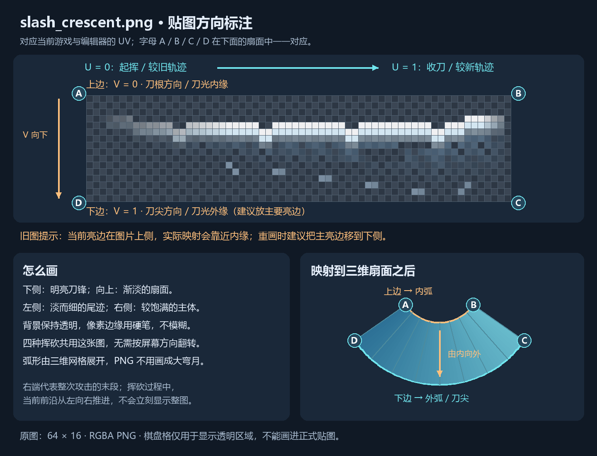

# slash_crescent 贴图方向

图按当前 `TrackedSlashTrails.draw` 的真实 UV 标注，原始贴图保持不变。

| PNG 的边 | 三维刀光上的位置 |
|---|---|
| 左边 U=0 | 一次挥砍的起始，较旧的轨迹 / 尾部 |
| 右边 U=1 | 一次挥砍的结束，较新的轨迹 / 前部 |
| 上边 V=0 | 第一锚点方向，刀光内缘 / 刀根方向 |
| 下边 V=1 | 最后锚点方向，刀光外缘 / 刀尖方向 |

横向 U 按整次挥砍的进度计算；攻击还没有进行到末段时，不会显示完整的右半边。头尾和寿命另外受到顶点透明度淡化。

纵向 V 沿有序锚点截面计算。加宽参数会把内缘向刀根内侧扩展，所以“上边”表示刀根方向，不保证正好落在实体护手上。

四种挥砍共用同一套 UV。屏幕上的左右、上下和斜向由世界网格运动决定，无须为反向挥砍另画或翻转 PNG。

建议下侧画主要亮边，上侧向透明过渡；左侧拖尾淡而细，右侧较饱满。三维网格已经负责把条带展开成扇面，PNG 可按长条材质绘制。当前旧贴图的亮边集中在上侧，与这个建议相反；标注图如实展示原图，没有自动翻转用户素材。

当前原图为 `src/main/resources/assets/rotten_ruins/textures/effect/slash_crescent.png`，64×16 RGBA。保留透明背景和最近邻采样，避免把棋盘格画进正式图片。白色/浅灰素材便于通过效果 JSON 的颜色参数染色，PNG 自带颜色会与该颜色相乘。

本说明针对 `renderer: "texture"`；`renderer: "shader"` 的主刀光由 GLSL 生成，不读取这张 PNG 的亮边形状。

运行 `python tools/annotate-slash-texture.py` 可按当前实际 PNG 重新生成方向标注图，不会覆盖正式材质。
